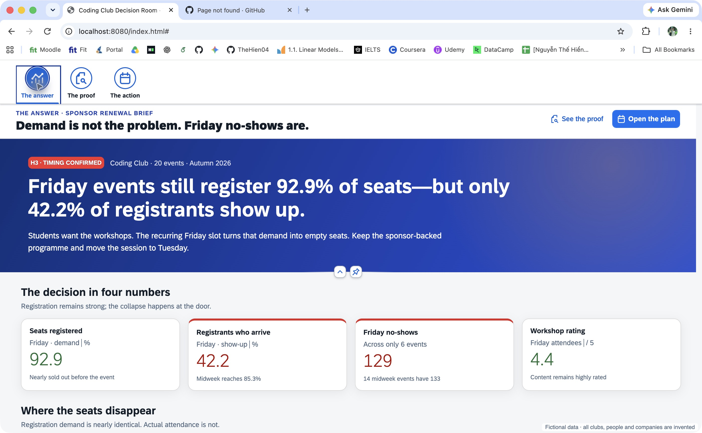
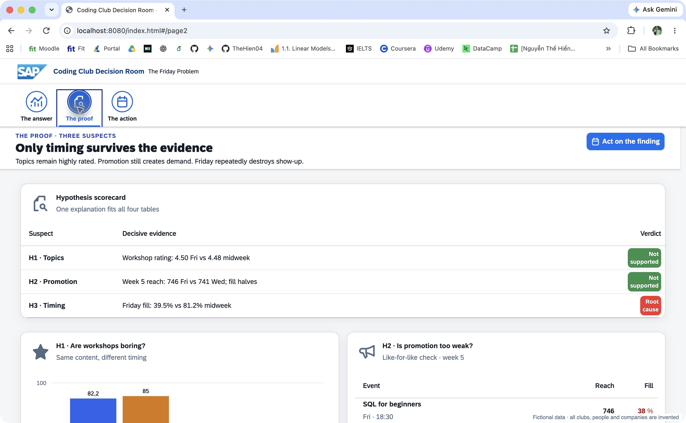
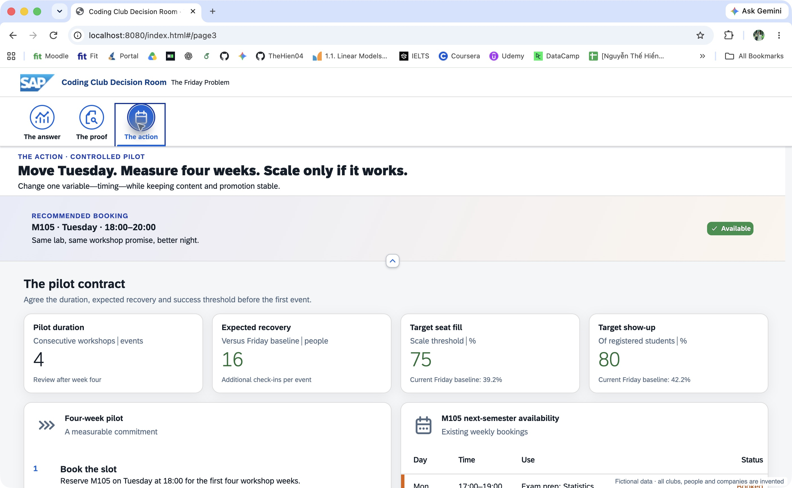

# The Friday Problem — Student Starter

This repository contains only the local SAPUI5 app and data needed for the hackathon. Use the deployed workshop URL shared by the facilitator to read the case, explore the SQLite data in the Query Playground, and browse reference UI blocks.

## Solution

The finished app is a three-page decision dashboard for the Coding Club:

1. **The answer** — demand remains strong, but the recurring Friday slot causes no-shows.
2. **The proof** — topic quality and promotion are ruled out; the Friday effect repeats across comparable clubs.
3. **The action** — move the workshop to M105 on Tuesday at 18:00 and run a controlled four-week pilot.

### Page 1 — The answer



### Page 2 — The proof



### Page 3 — The action



## Start

```bash
npm install
npm start
```

The browser opens **My App** at <http://localhost:8080>. Save a file and refresh the browser to see the change.

## Workflow

1. Read the problem at the deployed workshop URL.
2. Develop and test SQL in its Query Playground.
3. Add named queries to `webapp/data.js`.
4. Bind query results in `webapp/view/Page1.view.xml`.
5. Use Page 2 and Page 3 only when they strengthen the analysis.

Page 1 must communicate the finding, decisive evidence, and recommended action. The source contains `🧩` markers showing safe edit locations.

## Files students edit

| File | Purpose |
| --- | --- |
| `webapp/data.js` | Named read-only SQL queries exposed to UI5 data binding |
| `webapp/view/Page1.view.xml` | Required answer page |
| `webapp/view/Page2.view.xml` | Optional supporting page |
| `webapp/view/Page3.view.xml` | Optional supporting page |
| `webapp/view/App.view.xml` | App shell and page navigation |
| `webapp/controller/Page.controller.js` | Optional formatters and event handlers |

## Data binding

```javascript
membersByClub: sql(`
  SELECT name, members
  FROM clubs
  ORDER BY members DESC
`)
```

The query name becomes the binding path `{/membersByClub}`. Inside a repeated control, columns are bound as `{name}` and `{members}`. Use `sql.one(...)` for a single row and bind it as `{/queryName/column}`.

The app loads the committed SQLite database directly in the browser. There is no backend and all data is fictional.

## Check

```bash
npm run lint
```

`npm run lint` checks the UI5 application.
